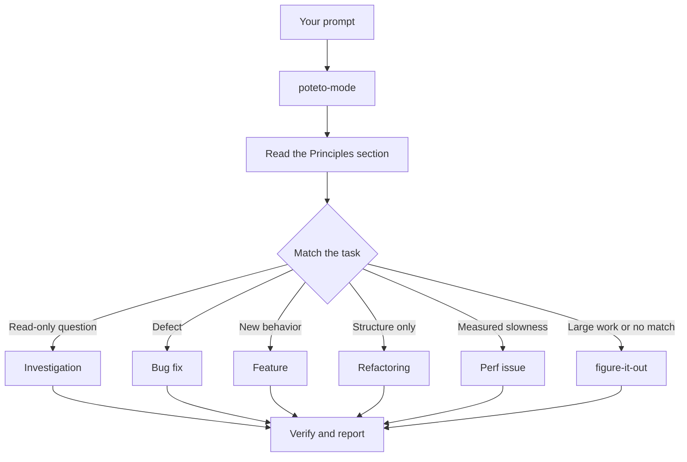

# `/poteto-mode` に作業を流す

`/poteto-mode` は玄関口である。ゴールを渡すと、23 本のプレイブックのうち 1 本にマッチさせ、そのプレイブックのステップを todo リストへコピーし、ステップが必要とするままに他の skill を呼ぶ。このページでは、良いプロンプトがどんなものか、そして実際にはどれだけ少なくて済むかを学ぶ。


## プロンプトに何が起きるか



図はよくある経路を示している。ほかにも、メトリクスのヒルクライム、ランタイムの症状と採取したトレースの診断、プロトタイプ、ビジュアルパリティ、skill の作成と評価、自律実行、PR やスタックを merge 可能な状態まで見守ること、検証済みスタックを出すこと、PR キューのオートパイロット実行、プロジェクト規模のプログラムのオーケストレーション、セッションの引き継ぎ、安全な中断、複数フェーズのプラン、worktree の掃除といったプレイブックがある。[プレイブックのディレクトリ](../../skills/poteto-mode/playbooks/) に全部が揃っている。

## 儀式ではなくゴールを言う

仕様書は書かない。何が壊れているか、何が欲しいかを言い、それに加えてエージェントの時間を節約できる既知の情報を添える:

```text
/poteto-mode users get two notifications after a retry. repro first, then fix and verify.
```

これは Bug fix のプロンプトである。「repro first」は礼儀ではなく実在の制約であり、プレイブックはそれを尊重する。todo リストが Bug fix のステップで埋まるのを見よ。飛ばされたステップは `skip: <reason>` 付きで見えたまま残る。

## プロンプトに何を入れるか

役に立つプロンプトは最大 5 つのものを運び、どれも 1 文に収まる:

- **ゴール。** 何が壊れているか、何が欲しいかを言う。
- **完了の確認。** 合否が出せるものでなければならない。「良くして」や「1 時間取り組んで」は確認ではない。
- **見たい証拠。** 実際のコマンド出力、フローの動画、保存された値、前後の数値を求める。
- **既に知っていること。** 症状、再現手順、ログの 1 行、リンクがあればエージェントの検索が 1 回省ける。
- **実在の制約。** 「repro first」「don't change any code yet」「zero behavior change」「let me review before proceeding」は、それぞれエージェントの行動を変える。

5 つすべてを備えたプロンプトの例:

```text
/poteto-mode the csv export drops its last row since yesterday's deploy. failing job id is 4812. repro first, then fix. done means the 60k-row fixture exports every row. show me the row counts before and after.
```

入れないほうがよいものが 2 つある:

- **やり方。** 何を達成するかを言い、あなたが選ぶ道よりも良い道をエージェントが見つける余地を残す。skill のリストも同じで、下の落とし穴で扱う。
- **原因についてのあなたの仮説、最初のうちは。** 口にした推測は、探索をあなたが指した場所へ狭める。自分の勘を伝えるのは、エージェントが問題を言い直してからにする。

長いスレッドや曖昧なバグなど、ノイズの多い報告では、言い直しを最初のステップにする:

```text
/poteto-mode read this thread. restate the underlying issue in your own words, in plain english. don't change any code yet.
```

読み違いは、コードが 1 行も存在しないうちに言い直しの中に現れる。そこで正せば、間違った修正 1 つ分ではなくメッセージ 1 通分のコストで済む。

## フォローアップは短く

会話が既に文脈を抱えているなら、プロンプトはほとんど何もない状態まで縮む。以下はどれも十分である:

```text
/poteto-mode do it
```

```text
continue
```

```text
keep going until done
```

短くて済むのは、プレイブックが構造を保持し、Custom Mode が毎ターン `/poteto-mode` をコンテキストに保つからである。[pstack をセットアップする](./01-setup.ja.md#最初のタスクを走らせる) がその始め方を示す。あなたの言葉が意図を運び、skill が厳密さを運ぶ。

## 「new task」でタスクを切り替える

長いチャットは直前のタスクの文脈を溜め込む。話題を変えるときは、そう言うこと:

```text
/poteto-mode new task. figure out why the cache entry survives logout. don't change any code yet.
```

「new task」は `/poteto-mode` に、直前のプレイブックの続きではなく再マッチせよと伝える。「don't change any code yet」はこれを Investigation に固定する。この 2 つのフレーズがないと、Feature の途中にあるモードはあなたの質問を次の feature ステップとして扱いがちになる。

## 並列作業にはそれぞれのマシンを与える

1 台のコンピュータ上で 1 つのリポジトリに対して複数のエージェントを走らせると、作業ツリー、ポート、ビルド出力を奪い合う。最もきれいな隔離は [cloud subagent](https://cursor.com/docs/subagents#cloud-subagents) である。それぞれが自分の VM とブランチを持つので、あなたのマシンに触れることなく依存関係を入れ、アプリを走らせ、結果の動画を録れる。タスクの前に `/in-cloud` と打つか、親チャットに作業を cloud subagent へ渡すよう頼む。

作業をローカルに留める必要があるときは、最初に worktree を要求すること:

```text
/poteto-mode new task. branch off <base> in a fresh worktree, then port the parser change there.
```

各タスクが自分のブランチと worktree を持つなら、どのエージェントも他人のファイルを踏まない。worktree はディスクとマシンのリソースを食うので、ラップトップで同時に走らせられるのは一握りだけである。[PR を開くプレイブック](../../skills/poteto-mode/playbooks/opening-a-pr.md) はコード変更に対して既に worktree から作業するので、これを言うのは特定のベースや場所が問題になるときだけでよい。

worktree は溜まっていく。ディスクが逼迫したら、こう頼む:

```text
/poteto-mode what's eating my disk? prune the worktrees that are safe to prune.
```

[Worktree cleanup プレイブック](../../skills/poteto-mode/playbooks/worktree-cleanup.md) は、マージ状態、未コミットの作業、まだ触っているチャットによって、すべての worktree を分類する。その証拠が問題ないと示したものだけを削除し、未コミットの作業を抱えるものについてはあなたの判断を待って止まる。

## 走らせたまま離れる

席を離れるときは、完了が何を意味するかを言って行けばよい:

```text
/poteto-mode im stepping away. keep going until the migration check reports zero old callers. log your decisions.
```

後から自分がレビューする作業は [`/figure-it-out`](../../skills/figure-it-out/SKILL.md) に流れる。これは実行のフェーズを設計し、[`/show-me-your-work`](../../skills/show-me-your-work/SKILL.md) の決定ログを維持する。[寝ている間に作業を走らせる](./07-overnight.ja.md) が夜間の契約の全体を扱う。

**落とし穴:** プロンプト内で skill を列挙しない (「use /how, then /architect, then /arena...」)。プレイブックが既にそれらを順序づけており、手書きの順序はたいてい、プレイブックなら残したはずのステップを並べ替えたり落としたりする。特定の選択を上書きしたいときにだけ skill 名を挙げること。

完全なルーティング規則は [`poteto-mode`](../../skills/poteto-mode/SKILL.md) 本体を読め。

次: [コードを理解する](./03-understand.ja.md)。
