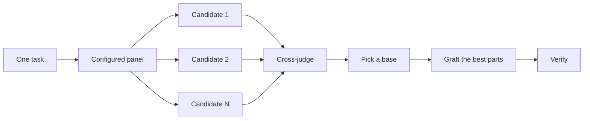

# コードを書く前に設計する

難しい設計を 1 回試すだけでは、モデルが最初に思いついた形を固定してしまう。`/architect` は実装の前に型と境界を決める。`/arena` は同じブリーフに対して複数回試み、最良の部分をマージする。`/interrogate` は他のモデルにその結果を壊させる。仕事が設計の統合ではなくカバレッジであるときは、`/swarm` がスライスやレースにファンアウトし、その結果を集約する。

よくある設計の間違いは 2 つある。エージェントの最初の設計をそのまま採ることと、どのコードにも試されていないプランを磨き続けることだ。このページはその両方を正す。コードを通してプランを立てる。プロトタイプが未解決の問いに答え、README やチュートリアルが目標を定め、書かれたプランは最後に来る。


## `/architect` で形を決める

```text
/architect design the import pipeline before writing any code. i care most about how callers use it.
```

[`/architect`](../../skills/architect/SKILL.md) はまず自らを grounding し、設計が触れるコードに対して `/how` を、所有権やレイヤーを動かすなら `/why` を走らせる。次に `/arena` を走らせて競合する設計スケッチを作る。各スケッチでは呼び出し側の使用例が最初に書かれ、続いて型、シグネチャ、モジュールマップが来る。

既定では、統合された設計からそのまま実装へ進む。先に設計を見たいなら、そう言うこと:

```text
/architect with checkpoint. stop and show me before implementing.
```

コードを書き始めたら、設計は神聖なものではない。実装の中で無関係な場所に同じ回避策が現れたり、`any` や強制キャストでしかコンパイルが通らない型が出てきたりしたら、`/architect` はそれを設計が間違っている証拠として扱う。継ぎ当てでしのぐのではなく、スケッチを捨ててやり直す。

## `/arena` で試行をファンアウトする

```text
/arena take my prompt to the arena verbatim. i want to compare their proposals with yours.
```

[`/arena`](../../skills/arena/SKILL.md) はその下にある汎用のツールである。N 個のサブエージェントが同じ設計またはコードのブリーフに並列で取り組み、それぞれが自分の worktree またはディレクトリに書く。読み取り専用のジャッジが、設定が許すなら別のモデルファミリで、すべての候補をルーブリックに照らして採点する。コーディネータは各候補を端から端まで読み、ベースを選び、敗者から最良のアイデアを接ぎ木し、結果を検証する。



パネルは [`/setup-pstack`](../../skills/setup-pstack/SKILL.md) の設定から来る。タスクごとに調整できる。判断が重要なら候補を増やし、そうでなければ減らすよう頼む:

```text
/arena this, 5 candidates. the cache key format is expensive to change later.
```

## `/swarm` でスライスとレースをカバーする

```text
/swarm check every package under packages/ against its check.sh. one worker per package. one report.
```

[`/swarm`](../../skills/swarm/SKILL.md) は N 個のワーカーを、独立したスライス、カバレッジマトリクス、ガントレットのレーン、探索の分割、宣言されたレースのアームに広げる。各ワーカーは自分のスコープとチェックを受け取り、`PASS`、`ISSUES`、`BLOCKED` のいずれかを報告する。親はワーカーを待ち、ギャップや脱落を含む 1 つのコンパクトな報告を返す。

並列性がカバレッジを買うとき、または独立したチェックを競わせられるときに使う。`/arena` はすべてのワーカーに同じ設計またはコードのブリーフを渡し、その後ベースを選んで最良の部分を接ぎ木する。`/swarm` はスライスをカバーするか、あらかじめ宣言された選択規則でレースを走らせる。ベース選択と接ぎ木の儀式は使わない。

## `/interrogate` で壊す

```text
/interrogate the whole branch, but skeptically. no nitpicks unless it's an actual bug or regression.
```

[`/interrogate`](../../skills/interrogate/SKILL.md) は同じ diff、意図、ルーブリックを、異なるモデルファミリのレビュワーに送る。モデルの多様性こそが要点である。モデルが違えば盲点も違うので、2 つのモデルが独立に挙げた指摘は確信度の高いシグナルである。リードはすべてを `Act on`、`Consider`、`Noted`、`Dismissed` に仕分けし、却下にはそれぞれ理由を付け、何も自動では適用しない。

却下も読むこと。リードは実務的なシニアエンジニアであって神託ではない。上書きしてよい。

## 議論の代わりにプロトタイプを作る

最初の設計を決して採らない。いくつか求め、目に見える証拠から選ぶ:

```text
/poteto-mode prototype a few options for the new dropdown menu. take screenshots or videos for me to compare.
```

[Prototype プレイブック](../../skills/poteto-mode/playbooks/prototype.md) は使い捨てのスケッチをスクラッチディレクトリに作り、バリアントを 1 つのスイッチャーの裏に並べ、それぞれを操作し、スクリーンショットかタイミングを取る。UI だけでなく、挙動やアルゴリズムにも使える。プロトタイプはコードによるプランニングである。エージェントはあなたに聞く代わりに何かを走らせて自分の未解決の問いに答えられ、あなたが思いつかなかった選択肢の余地も残る。

同じ考え方は本物の設計にも広げられる。`/architect` とプロトタイプを組み合わせ、レビューのゲートを残す:

```text
/poteto-mode we need rate limiting for external webhooks. /architect it first, and answer open questions with prototypes. let me review before proceeding.
```

抽象的なプランにレビュワーを費やさない。`/interrogate` は diff に対して使うものである。背後にコードの無いプランへ敵対的なレビューを向けると、レビュワーは決して起こらない理論上のリスクやエッジケースをでっち上げる。プロトタイプに問いを決着させ、それから作られたものをレビューする。

## 共有コードでは README を先に書く

他のコードが使うパッケージや API では、ユーザが読むドキュメントから始める:

```text
/poteto-mode write a tutorial for how i would use the new config package first. then /teach me why it beats the current one.
```

チュートリアルを先に書くと、呼び出し側の視点が強制される。仮想のユーザに API を説明し、そこから実装へ遡る。ドキュメントは、エージェントが自分の作業を照らし合わせる具体的な目標にもなる。ドキュメントそのものが重要なときは [`/technical-writing`](../../skills/technical-writing/SKILL.md) を名指しする。そうすればチュートリアルはチュートリアルのまま保たれ、リファレンスと解説を同時に兼ねる方向へ流れない。

## 設計が固まってからプランを立てる

pstack には意図的にプランニングの skill が無い。書かれたプランが欲しいときは、設計が固まってから頼む:

```text
/poteto-mode turn this design into a plan. small verifiable PRs, each with its own verification steps.
```

[Multi-phase plan プレイブック](../../skills/poteto-mode/playbooks/multi-phase-plan.md) は残った未解決の問いをプロトタイプで決着させ、それから PR ごとに 1 セクションを書く。各セクションは変更が動くことの証明で終わる。テストスイートが通るだけでは、その証明にはならない。プランが成果物である。このプレイブックはプランを実装せず、次にどの実行用プレイブックがそれを走らせるべきかを名指しする。

移行では、プロンプトで基準を述べる:

```text
/poteto-mode plan the migration of our ui library to the new styling system. small verifiable PRs, each with visual regression checks. the result must match the original exactly, bugs included.
```

「bugs included」は、移行が途中でこっそり何かを直すのを防ぐ。それをやると新旧の出力を比較できなくなる。何日にもわたるプロジェクトでは、他のエージェントが進行中の作業を見られるよう、プランをしばらくリポジトリにコミットしておいてもよい。作業が着地したら削除する。

## タスクにはどれだけの設計作業がふさわしいか

すべての変更にこれが必要なのかと思うかもしれない。必要ない。ほとんどの変更にはどれも要らない。おおまかな梯子:

- 小さく完成した変更で自信が持てないものには `/interrogate` だけでよい。
- 関数の境界を越える、または所有権を動かす変更は `/architect` に値する。`/architect` は `/arena` を連れてくる。
- 命名、フォーマット、アルゴリズムのように、独立した試行が役立つ単独の判断は `/arena` を直接使う。
- カバレッジマトリクス、並列チェックの集合、アームを宣言したレースは `/swarm`。
- レイアウト、タイミング、アプローチのように、何かを走らせれば答えられる未解決の問いには、議論ではなくプロトタイプ。
- 争点があり、覆すのが高くつく設計には `/architect`、そして出す前に `/interrogate`。
- 複数の PR にまたがる作業にはプラン。設計が固まってから書く。

`/poteto-mode` はすでにこの梯子を適用している。境界を越える作業は自ずと `/architect` を起動するので、これらを直接使うのは主に、既定より多くの、あるいは少ない精査が欲しいときである。

次: [変更をビルドして綺麗にする](./05-build-and-clean.ja.md)。
