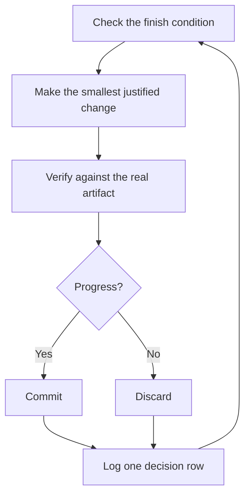

# 寝ている間に作業を走らせる

これがここまでの全ての見返りだ。自分の作業を自分で検証できると信頼できるエージェントは、難しいタスクを任せて放っておけるエージェントだ。それを安全にするのは希望的観測ではない。チェック可能な完了条件、隔離された worktree またはクラウドエージェント、そして朝に監査できる決定ログである。


## ループの前に信頼を得る

信頼できないループは、未検証の作業をより速く生み出すだけであり、混乱はイテレーションのたびに積み重なる。ループを走らせたまま離れる前に、それが信頼に値するかを確かめる:

- そのタスクを一度自分の手でやったか、エージェントがやるのを見ていて、良い結果がどういうものか分かっている。
- エージェントが、あなた自身が使うツールとシグナルを持っている。検証 skill、プロファイラ、ログ。
- どのステージも自分の作業を証明し、作業が基準に届かないときはラインを止められる。
- transcript をいくつか読み、繰り返される失敗をツール、skill、チェックに変えた。

4 つすべてが成り立ってから、ループを自律させる。それまでは、見ている前で走らせる。

## 一晩の契約

よい引き継ぎには、ゴール、完了条件、権限、そして脱出ハッチがある。長い必要はない:

```text
/poteto-mode im going to bed. migrate every caller to the new parser in a fresh worktree off <base>.
done means zero old callers, all parser fixtures pass, old api deleted.
keep a decision log. don't ask me before committing.
/loop until done. if you're truly stuck after a few hours, stop and write up why.
```

各行が何を買っているのかを見ていこう:

- 「im going to bed」はセッションのオーバーライドだ。エージェントは尋ねるのをやめ、進み続ける。
- 「done means...」はゴールを、各イテレーションが実行できるチェックに変える。
- 「fresh worktree off `<base>`」は、この実行が他に開いている作業と衝突しないようにする。
- 「don't ask me before committing」は、さもなければエージェントがブロックする権限確認に先回りして答えている。
- `/loop` は Cursor の組み込みの wake 機構であり、pstack の skill ではない。[Autonomous run playbook](../../skills/poteto-mode/playbooks/autonomous-run.md) はこれを使って、イベントまたは heartbeat のたびに完了条件を再チェックする。
- 脱出ハッチは、本物の行き止まりで止まって理由を書き残すことを許す。8 時間かけてゴールを創造的に解釈し直されるよりずっとよい。

この作業は席を外した後にレビューすることになるので、`/poteto-mode` はそれを [`/figure-it-out`](../../skills/figure-it-out/SKILL.md) 経由に回す。これはコードを書く前に実行のフェーズを設計し、決定ログを組み込む。

意図的に実行を止めるには、一時停止するよう、あるいはこれからオフラインになる、Cursor を再起動するとエージェントに伝える。[Pause safely playbook](../../skills/poteto-mode/playbooks/pause-safely.md) は現在のステップを終えるか取り消し、作業途中のチェックポイントをコミットし、再開用のメモを書く。新しいチャットは Session pickup playbook を通してそのメモから作業を引き継ぐ。「keep going」と言っても一時停止は決して発動しない。

## ループが一晩やること



1 イテレーションにつき 1 変更、1 チェック、1 ログ行。役に立たなかった変更は、そのまま残さず破棄する。プラトーは停止ではなく方向転換を意味し、勝利宣言のために完了条件がこっそり緩むことはない。

## 朝の監査

[`/show-me-your-work`](../../skills/show-me-your-work/SKILL.md) が、この実行をレビュー可能にする。各行は時刻、フェーズ、決定、理由、証拠へのポインタ、結果を記録し、`decisions.tsv` (複数の実行が同じディレクトリを共有する場合は `.audit/<task-slug>.tsv`) の TSV に残る。既定ではローカルに留まる。レビュワーが結果を信頼するのに trail が要るほど野心的な作業なら、コミットする。

戻ってきたら、実行をレビュー形式で出させる:

```text
/show-me-your-work catch me up on what you did last night
```

この skill はサマリーを返す前に、別のモデルファミリーのレビュワーを起動して trail と transcript を読ませ、返答の末尾には注視すべきものを挙げた Attention セクションが付く。まずそのセクションを読み、次にそれが指すログ行を読む。監査しているのは決定であって、一晩ぶんを読み直すことではない。

## 夜が抱えるのがタスクではなくキューのとき

上の契約は、ひとつのタスクをひとつの完了条件まで駆動する。夜によってはそれ以上を抱える。独立した変更のキューや、プログラム全体だ。3 つの playbook が同じ信頼をスケールさせる。

[Autopilot-full](../../skills/poteto-mode/playbooks/autopilot-full.md) は独立した PR のキューを merge まで走らせる。各 PR には owner エージェントが 1 体つき、build から merge まで運ぶ。どの owner も自分の verdict では merge しない。新鮮な verifier の swarm は owner の code-ready な head でラウンドを開始し、patch を変える後続の push のたびに再び開始する。merge される patch に対する clean な verdict だけが merge を認可する:

```text
/poteto-mode full autopilot on this queue. each item is independent. i want them merged by morning.
```

[Autopilot-stack](../../skills/poteto-mode/playbooks/autopilot-stack.md) は同じ owner ループを走らせるが、何も出さない。起きると、各リンクに verifier の verdict が付いた 1 本の線形な base-branch スタックができており、レビューして自分で着地させる。変更が結合しているとき、あるいは何かが merge される前に自分の目で作業を見たいときは、Autopilot-full よりこちらを選ぶ:

```text
/poteto-mode autopilot these five changes but stack them, don't ship. i'll land the stack in the morning.
```

[Orchestrate](../../skills/poteto-mode/playbooks/orchestrate.md) は、単一のエージェントの寿命を超えるプログラム向けだ。複数日、多数のスタックされた PR、ひとつの常設 coordinator チャットの下にあるサブエージェントの群れ。coordinator は brief を書き、サブエージェントが仕上げたものを集め、最下位の未 merge PR を green に保ち、自分ではコードを書かない。意図的に重量級の機構である。1 体のエージェントが 1 セッションで終えられる作業なら、この playbook 自身が上の一晩の契約へ差し戻す:

```text
/poteto-mode orchestrate the store migration. own it until every package is converted and merged. i'll check in twice a day.
```

## 多数のプロジェクトを並列に走らせる

[Cursor Project](https://cursor.com/blog/projects) は、1 体の coordinator エージェントに永続的なスレッドを与える。coordinator はコードを書かない。サブエージェントに指示を出し、サブエージェントは既定でクラウドで走るので、ラップトップを閉じても作業は続く。これは Orchestrate playbook が想定する形である。coordinator へのプロンプトを `/poteto-mode` で始めれば、それが起動するサブエージェントは playbook に従う。

役に立つ習慣がいくつかある:

- 機能、マイグレーション、パフォーマンス改善、技術的負債の掃除といった作業のまとまりごとに、それぞれの Project を与える。複数を並べて走らせられる。
- 関連するチャットを、終わったものも含めて Project にドラッグする。それらは Project 内のすべてのエージェントのコンテキストになる。
- 各 PR にはマージ前に verification swarm を付け、キューは Autopilot-stack か Autopilot-full に運ばせる。
- coordinator にはデータに裏付けられた計画を求め、あなたに尋ねる前に未決の問いを試作で答えさせる。

1 つのプロンプトで、調査から実行まで Project 全体を運べる:

```text
/poteto-mode refactor this repo so its architecture is more agent friendly. use /correct and /architect on past commits and review comments to find the mistakes agents make most here. use /recall for context from past chats. answer open questions with prototypes instead of asking me. come back with a plan backed by real data. once i approve it, run it with autopilot-stack or autopilot-full, and ask me which.
```

## ループを自分で始めさせる

ここまでのループはどれも、あなたが始めるのを待っている。スケジュールやイベント駆動の automation がそのステップを取り除く。ソフトウェアの保守は、これに向いたステージに分かれる。レポートのトリアージ、再現、修正、修正の検証。そうしたラインを信頼できるものに保つルールは 2 つある:

- どのステージもラインを止められる。トリアージはレポートを想定どおりの挙動と判断でき、再現は再現に失敗でき、修正担当は変更がリスクが高すぎると判断できる。どの結末も役に立つ。悪い作業が、取り消すのにより高くつく次のステージへ届くのを防ぐからだ。
- どのステージも証拠を引き渡す。再現は壊れた状態のスクリーンショットと動画を添付し、修正は前後の証明を添付する。そうすれば人間は、コードを 1 行も読む前に、エージェントが正しいものを直したかを確かめられる。

pstack はこれを、Slack の issue レポート向けの休眠中の [automation pack](../../automations/benny/README.md) として同梱している。1 つの automation が各レポートをトリアージする。もう 1 つは確認されたバグを再現し、小さなドラフトの修正を用意することもある。エージェントにその [`FOR_AGENTS.md`](../../automations/benny/FOR_AGENTS.md) を示し、対象のリポジトリを名指しすればセットアップできる。

**落とし穴:** 時間の長さは完了条件ではない。「4 時間これをやって」ではエージェントにチェックすべきものが何も与えられず、起きたときにあるのは結果ではなく 4 時間ぶんの動きだ。`/loop` には合否を判定できる述語を与えること。

次: [原則の名前で舵を取る](./08-principles.ja.md)。
